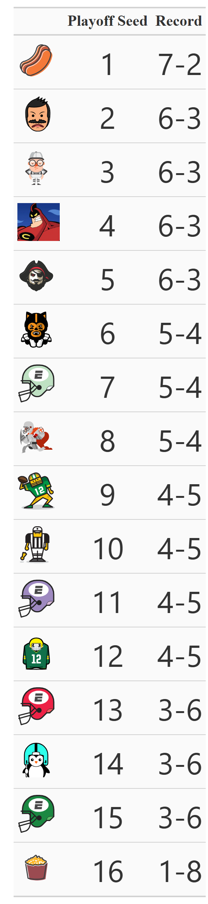

  #  2026-OPTFFL 

2026 OPTFFL Season Documents
* **[`Recaps/`](Recaps/)** — Includes weekly Recaps.
* **[`Recaps/QZN Plots/`](Recaps/QZN%20Plots/)** — Contains visuals for special recaps every quarter of the season.
* **[`Standings Tables/`](Standings%20Tables/)** — Contains image of current and weekly rankings.
* **[`team_logos/`](team_logos/)** — Contains .png file for each team that is used in plots.
* **[`2026 OPTFFL connect.R`](2026%20OPTFFL%20connect.R)** — The most important file, its where weekly recap images and rankings are created!
* **[`quarterSZN2026_analysis.R`](quarterSZN2026_analysis.R)** — This is where the visuals for the quarter season special reports are made.

# Current Points

| Total Points Animation | Current Standings |
| :---: | :---: |
|  |  |

# Quarter Season Plots

  <b>Projected Points - Actual Points</b>

| Ordered by Standings | Ordered By Average Points Scored |
| :---: | :---: |
|  |  |

  <b>Other Charts</b>

| Scoring Ridge Plot | Ordered By Average Points Scored | Points for vs Against |
| :---: | :---: | :---: |
|  |  |  |
